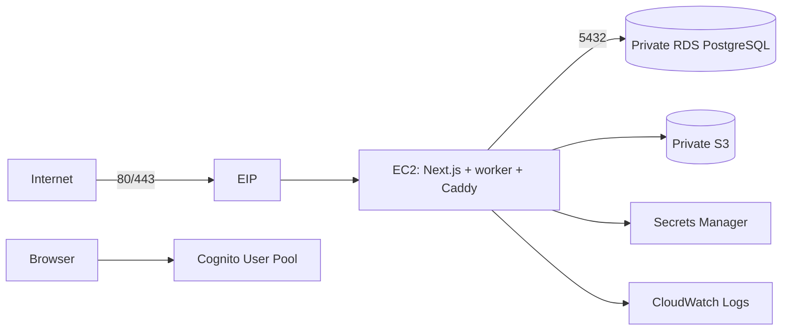

# FinSig AWS infrastructure

Target: account `623588627433`, region `eu-central-1`, environment `dev`. This is the AWS baseline from the product plan, not an application deployment. It provisions a single EC2 host for Next.js, worker and Caddy; a private PostgreSQL RDS instance; private S3 uploads; Cognito; one Secrets Manager secret shell; CloudWatch log group; and an account-wide monthly cost budget. It does not yet install Docker, deploy the app, configure DNS/TLS, create a least-privilege PostgreSQL application user, or populate application secrets.

## Layout

```text
infra/
  bootstrap/           S3 state bucket, local bootstrap state
  deploy-identity/     GitHub OIDC provider and FinSig_admin deploy role
  envs/dev/            one composition root and remote state
  modules/
    network/           VPC, public app subnet, two private DB subnets, security groups
    app/               EC2, EIP, SSM role, app secret shell, log group
    database/          private PostgreSQL, RDS-managed master secret
    storage/           private, versioned S3 uploads
    identity/          invite-only Cognito user pool and OAuth code client
    budget/            account-wide monthly actual/forecast alerts
```



The EC2 subnet has an internet gateway and no NAT gateway. RDS uses private subnets in two Availability Zones, has no public endpoint, and accepts PostgreSQL only from the EC2 security group. The instance has no SSH ingress and requires IMDSv2; use Systems Manager Session Manager. The RDS master password is generated and stored by RDS in Secrets Manager, so it does not enter Terraform variables or state as a plaintext value. The EC2 role can read only its application configuration secret, not the RDS master secret. The application secret is created without a value; fill it outside Terraform after creating an application DB role.

## Apply sequence

The [GitHub deployment identity](deploy-identity/README.md) is an independent
Terraform root. Applying it creates the role only and does not provision the
application stack or the state bucket.

1. Sign in with a non-root IAM or IAM Identity Center principal in the personal account. `./scripts/aws-finsig identity` must report account `623588627433` without the root warning. The wrapper checks account and principal before any Terraform command. The provider and S3 backend independently allow only this account. Raw `terraform` or `aws` in the directory does not automatically switch accounts.
2. From the repository root, run `./scripts/aws-finsig terraform -chdir=infra/bootstrap init`, then `plan`, then review and `apply`. This creates the S3 state bucket. Bootstrap's local state is gitignored; keep a secure backup of it. Do not delete the state bucket while dev state exists.
3. Copy `infra/envs/dev/backend.hcl.example` to `backend.hcl`, and `terraform.tfvars.example` to `terraform.tfvars`. Replace the example HTTPS origin and budget email with real values. An HTTPS origin is required for Cognito callbacks even though the app is not deployed yet.
4. Run `./scripts/aws-finsig terraform -chdir=infra/envs/dev init -backend-config=backend.hcl`, then `plan -out=dev.tfplan`. Review the resource list and costs; run `apply dev.tfplan` only when ready to provision. The plan file is gitignored because it can contain sensitive infrastructure data.

For syntax checks without AWS credentials, use `terraform -chdir=infra/bootstrap init -backend=false`, `terraform -chdir=infra/envs/dev init -backend=false`, then `terraform fmt -check -recursive infra` and `terraform -chdir=infra/envs/dev validate`. These commands do not create AWS resources.

The S3 backend uses S3 lock files, versioning and server-side encryption. Terraform 1.14's backend does not consume `aws login` directly; the ignored project-local `finsig-terraform` profile delegates to `aws configure export-credentials` for the project-local login profile. The config and login cache never use the global AWS profile. Do not put access keys in `.tfvars`, backend config or Git.

## Decisions and follow-up

- `app_base_url` is an HTTPS origin. Create its DNS A record pointing at `app_public_ip`, then deploy Caddy and the app. Cognito's callback is `${app_base_url}/auth/callback`; implement this route before user sign-in.
- The Cognito pool is invite-only. Its public client is configured for authorization code flow without a client secret; the app must use PKCE. Cognito is for FinSig login; it does not grant PayPal reporting access.
- The `app-config` secret is metadata only. Set its value through a guarded AWS command after DB application-user creation. Keep PayPal credentials out of Terraform.
- CloudWatch creates a 14-day log group, but the app must be configured to publish logs to it. EC2 is initially an empty Amazon Linux host; SSM Agent availability and deployment still need an integration check.
- RDS has deletion protection, seven-day backups and a final snapshot. S3 versioning retains previous objects. These protections can continue to incur charges after the app is stopped.
- The budget is **account-wide** and sends alerts; it is not a hard spending cap. EC2, RDS, IPv4, S3, snapshots, Secrets Manager and CloudWatch can incur charges as soon as they are created. Set or verify billing alerts before applying the dev stack.
- The AWS setup does not resolve PayPal delegated access. Current FinSig reporting is verified only for the first-party sandbox merchant.

Provider and service references: [S3 backend and lock file](https://developer.hashicorp.com/terraform/language/backend/s3), [RDS subnet groups](https://docs.aws.amazon.com/AmazonRDS/latest/UserGuide/USER_CreateDBInstance.html), [EC2 SSM permissions](https://docs.aws.amazon.com/systems-manager/latest/userguide/setup-instance-permissions.html), [AWS login credential process](https://docs.aws.amazon.com/cli/latest/userguide/cli-configure-sign-in.html).
